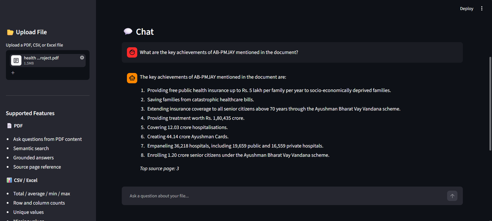
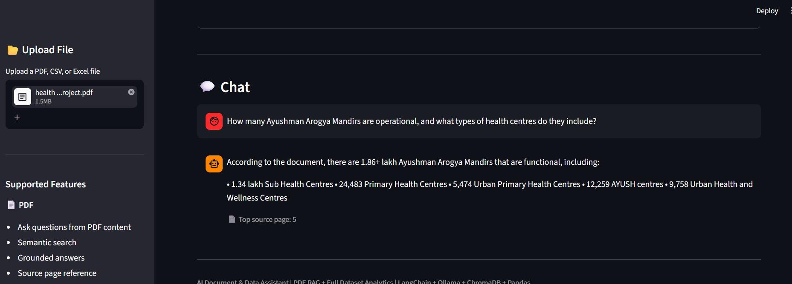
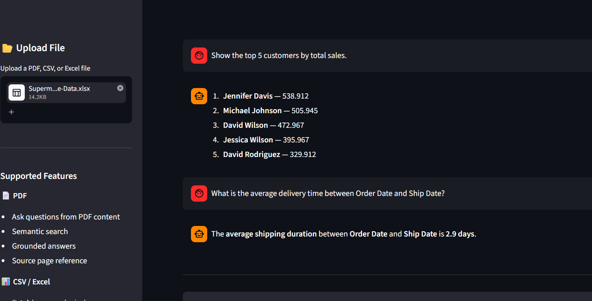

# 🤖 AI Document & Data Assistant

An AI-powered **Document Question Answering and Data Analysis Assistant** built using Retrieval-Augmented Generation (RAG), local LLMs, hybrid retrieval, OCR, and full-dataset analytics.

Users can upload **PDF documents, CSV files, and Excel datasets** and ask questions using natural language through a Streamlit interface.

---

## 🚀 Features

### 📄 PDF Question Answering

- Upload and query PDF documents
- Supports text-based and scanned PDFs
- OCR support for scanned pages
- Page-aware document chunking
- Retrieval-Augmented Generation (RAG)
- Hybrid retrieval using ChromaDB + BM25
- Multi-query retrieval
- Evidence retrieval and ranking
- Evidence-grounded answer generation
- Answer verification
- Source-page citations

### 📊 Excel & CSV Data Analysis

- Upload CSV, XLS, and XLSX datasets
- Ask questions using natural language
- Analyze the complete dataset using Pandas
- Sum, average, count, minimum, maximum and median
- Group-by analysis
- Top-N and bottom-N analysis
- Natural-language filtering
- Multiple-condition filtering
- Date-based analysis
- Monthly and yearly trends
- Delivery-duration calculations

---

## 🛠️ Tech Stack

### Programming
- Python

### Frontend
- Streamlit

### Generative AI & RAG
- LangChain
- Ollama
- Llama 3.2
- Nomic Embeddings

### Retrieval
- ChromaDB
- BM25
- Hybrid Retrieval
- Multi-Query Retrieval

### Document Processing
- PyPDF
- PyMuPDF
- Tesseract OCR
- Pillow

### Data Analytics
- Pandas
- NumPy
- OpenPyXL

---

## 🧠 RAG Architecture

```text
PDF Upload
     ↓
Text Extraction + OCR
     ↓
Page-Aware Chunking
     ↓
Nomic Embeddings
     ↓
ChromaDB + BM25
     ↓
Hybrid + Multi-Query Retrieval
     ↓
Evidence Retrieval & Ranking
     ↓
Llama 3.2
     ↓
Answer Verification
     ↓
Grounded Answer + Source Page Citation
```

---

## 📊 Data Analysis Workflow

```text
CSV / Excel Upload
        ↓
Dataset Cleaning
        ↓
Schema Detection
        ↓
Natural-Language Question
        ↓
Analysis Plan
        ↓
Pandas Execution
        ↓
Full-Dataset Calculation
        ↓
Final Answer
```

The LLM interprets the user's analytical request while **Pandas performs calculations on the complete dataset**.

---

## 📸 Demo Screenshots

### PDF Question Answering



### Source Page Citation



### Excel / CSV Data Analysis



---

## 🧪 Evaluation

The PDF RAG system was tested using document-specific questions covering factual, numerical, and multi-section information retrieval.

### Results

- ✅ **80% — Fully Correct Answers**
- ⚠️ **20% — Partially Correct Answers**
- ❌ **0% — Completely Incorrect Answers**

### Key Findings

- Strong performance on direct factual questions
- Strong numerical information retrieval
- Correct source-page identification
- Reliable performance on single-topic questions
- Partial answers mainly occurred when information was distributed across multiple PDF sections
- Evaluation findings are being used to improve retrieval and answer verification

> **Note:** Results are based on an initial limited test set and represent project-level evaluation rather than production-level accuracy.

---

## 💡 Example Questions

### PDF

```text
What are the key achievements mentioned in the document?

What services are provided through the healthcare programme?

How many centres are operational according to the document?

What are the major findings mentioned in the document?

Summarize the document based on the available evidence.
```

### Excel / CSV

```text
What is the total sales amount?

Show the top 5 customers by total sales.

What is the total order quantity?

Compare monthly sales.

What is the average delivery duration?

Which order has the highest total value?
```

---

## 🔍 How It Works

### PDF Documents

The application extracts text from uploaded PDFs. If usable text cannot be extracted from a page, OCR is used to recover text from scanned content.

The extracted content is divided into page-aware chunks and indexed using embeddings.

The retrieval pipeline combines **ChromaDB semantic search and BM25 keyword search** to retrieve relevant evidence.

The retrieved evidence is ranked and passed to **Llama 3.2**, which generates an answer grounded in the available document evidence.

The answer is then verified before being returned with source-page information.

### Excel & CSV Files

For structured datasets, the application separates natural-language understanding from data calculation.

```text
User Question
     ↓
LLM Understands the Request
     ↓
Pandas Executes the Analysis
     ↓
Complete Dataset is Analyzed
     ↓
Result Returned to User
```

This approach allows calculations to be performed directly on the complete dataset instead of asking the LLM to calculate results from sample rows.

---

## 💻 Run Locally

### 1. Clone the Repository

```bash
git clone YOUR_GITHUB_REPOSITORY_URL
cd RAG-AI-Document-Assistant
```

### 2. Create a Virtual Environment

```bash
python -m venv venv
```

On Windows:

```bash
venv\Scripts\activate
```

### 3. Install Dependencies

```bash
pip install -r requirements.txt
```

### 4. Install Required Ollama Models

```bash
ollama pull llama3.2:3b
ollama pull nomic-embed-text
```

Start Ollama:

```bash
ollama serve
```

### 5. Run the Streamlit Application

```bash
streamlit run app.py
```

The application will open in your browser through the local Streamlit server.

---

## 📁 Project Structure

```text
RAG-AI-Document-Assistant/
│
├── Screenshots/
│   ├── excel-analysis.png
│   ├── home.png
│   ├── pdf-question-answer.png
│   └── source-citations.png
│
├── app.py
├── requirements.txt
├── README.md
└── .gitignore
```

The local virtual environment (`venv`) is excluded from GitHub using `.gitignore`.

---

## ⚠️ Current Limitations

- Multi-section PDF questions may occasionally return partially complete answers
- Complex tables, multi-column layouts, and low-quality scanned PDFs can affect retrieval accuracy
- OCR performance depends on the quality and readability of scanned documents
- Currency values are calculated correctly but may not automatically display the original currency symbol
- Ollama and the LLM models currently run locally, so the application requires local model setup

---

## 🔮 Future Improvements

- 🌐 Deploy the assistant online for access from any device
- 📂 Support multiple PDF and Excel files in a single conversation
- 📊 Generate interactive charts and dashboards automatically from uploaded datasets
- 💾 Add conversation history so users can save and continue previous analyses
- 📤 Allow users to download AI-generated reports and analysis results as Excel or PDF files

---

## 🎯 Project Objective

This project demonstrates practical implementation of:

- Retrieval-Augmented Generation (RAG)
- Large Language Model applications
- Prompt engineering
- Embeddings
- Vector databases
- Hybrid information retrieval
- OCR and document processing
- LLM evaluation
- Python data analytics
- Natural-language dataset analysis
- Streamlit application development

---

## 👩‍💻 Author

**Kathi Jyoshna**

BCA — Data Science  
AI / Generative AI / Data Analytics

---

## 📄 Project Purpose

This project was developed as a portfolio project to demonstrate the end-to-end development, testing, and evaluation of an AI-powered document and data analysis application.